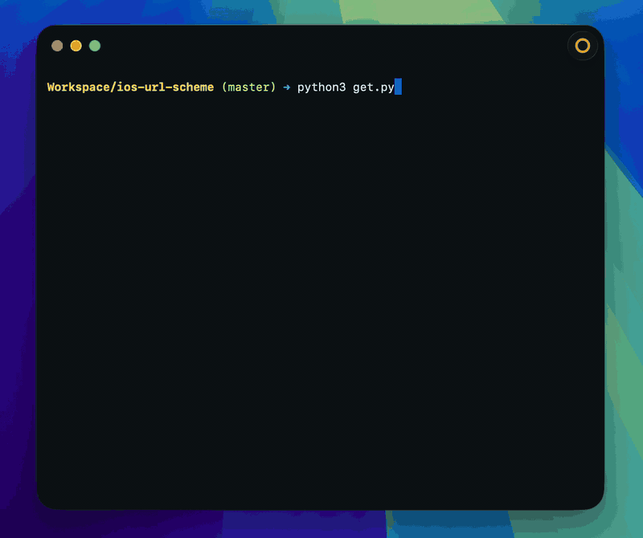

# iOS URL Scheme Parse

Language: **en-US** / [zh-CN](https://github.com/rijieli/ios-url-scheme/blob/master/README%5BZH%5D.md)



This script is used to parse the URL Scheme in iOS IPA files and can be used for iOS Shortcuts automation operations.

## Requirements

- macOS
- Python 3
- An Apple ID that can use the App Store
- [Homebrew](https://brew.sh) and [ipatool](https://github.com/majd/ipatool) (installed automatically if missing)

## Usage

```
$ python3 get.py
$ python3 get.py WeChat
$ python3 get.py -l 20 Telegram
$ python3 get.py -y
```

```
$ python3 get.py -h
```

`get.py` fails immediately on non-macOS systems. If `ipatool` is missing, it prompts to install Homebrew (when needed) and then `ipatool`. After App Store login, search for an app, select a result, and the IPA is saved to `apps/` and scanned for URL Schemes.

To parse IPA files you already have, put them in `apps/` and run:

```
$ python3 parse_ipa.py
```

## License

MIT
