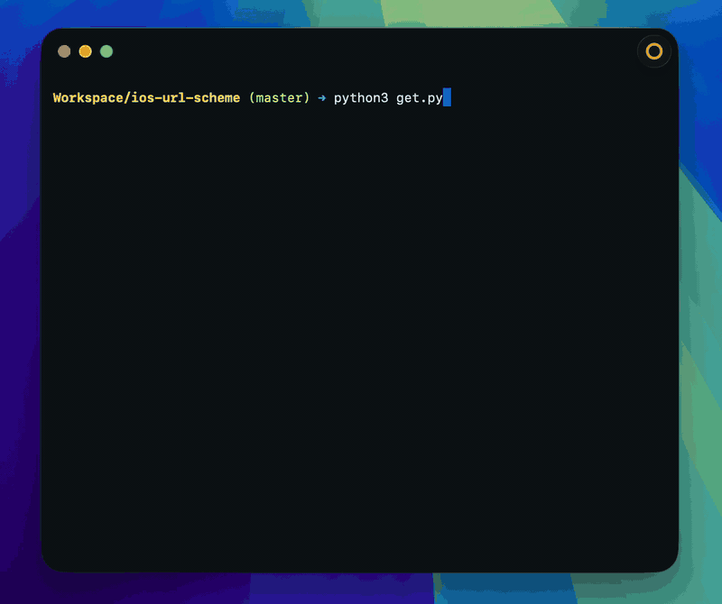

# iOS URL Scheme 解析

语言：**[en-US](https://github.com/rijieli/ios-url-scheme/blob/master/README.md)** / zh-CN



该脚本用来解析 iOS IPA 文件中的 URL Scheme，可以用在快捷指令自动化操作。在使用该脚本前，优先推荐在[捷径社区](https://sharecuts.cn/apps)直接搜索应用名称，避免重复劳动，有未收录的 URL Scheme 也欢迎联系社区管理员进行提交。

## 环境要求

- macOS
- Python 3
- 可用于 App Store 的 Apple ID
- [Homebrew](https://brew.sh) 和 [ipatool](https://github.com/majd/ipatool)（缺失时会自动安装）

## 使用方式

```
$ python3 get.py
$ python3 get.py 微信
$ python3 get.py -l 20 Telegram
$ python3 get.py -y
```

```
$ python3 get.py -h
```

`get.py` 在非 macOS 系统上会立即退出。若未安装 `ipatool`，会提示安装 Homebrew（如需要）再安装 `ipatool`。登录 App Store 后搜索应用、选择结果，IPA 会保存到 `apps/` 并解析 URL Scheme。

若已有 IPA 文件，将其放入 `apps/` 后运行：

```
$ python3 parse_ipa.py
```

## License

MIT
